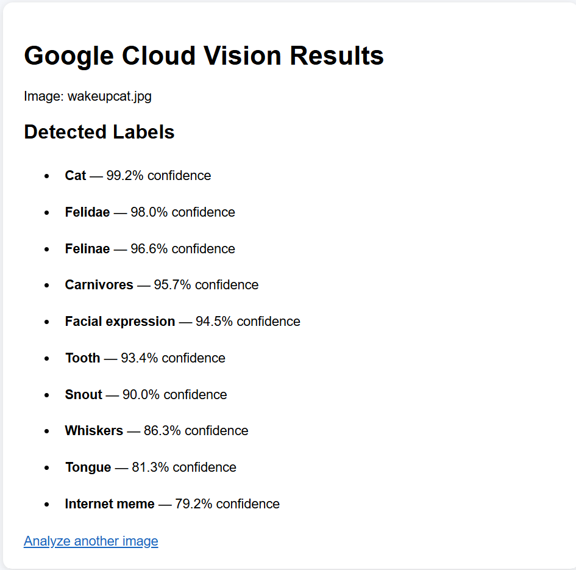

# Google Cloud Vision Image Analyzer

A Node.js and Express application that identifies objects and concepts in an uploaded image using Google Cloud Vision label detection. Results appear in the browser with confidence percentages.

**Live application:** [Open the image analyzer](https://g21-express-20261022-vk.uc.r.appspot.com)

## How it works

```text
Browser -> Google App Engine -> Node.js / Express -> Multer
        -> Google Cloud Vision API -> labels + confidence scores -> browser
```

Express serves the upload form and handles `POST /analyze`. Multer accepts one JPEG, PNG, or WebP image, up to 5 MiB, in the `pic` form field. The image stays in memory while the Vision client sends its bytes for label detection. Express returns an HTML results page with escaped labels and confidence scores. The app does not persist uploaded images or use a database.

## Project files

| File | Purpose |
| --- | --- |
| `server.js` | Express routes, upload validation, Vision API calls, and HTML results. |
| `public/index.html` | Browser upload form. |
| `package.json` | Dependencies and the `npm start` command. |
| `package-lock.json` | Locked dependency versions. |
| `app.yaml` | App Engine Standard deployment settings. |
| `.gitignore` | Files excluded from Git. |
| `.gcloudignore` | Files excluded from deployment. |
| [DEPLOYMENT-REPORT.md](DEPLOYMENT-REPORT.md) | Deployment evidence, setup command log, and presentation script. |

## Run locally on Windows

Use PowerShell with Git, Node.js 24, npm, and the [Google Cloud CLI](https://cloud.google.com/sdk/docs/install) installed. Google Cloud billing must be enabled, and your account needs access to the project and permission to use the required APIs.

Clone the repository if you do not already have a checkout:

```powershell
git clone https://github.com/Ncoumba/saas-google-vision.git
cd saas-google-vision
npm install
```

Configure CLI authentication and Application Default Credentials (ADC). CLI authentication is used for Google Cloud administration; the local Vision client uses ADC.

```powershell
gcloud auth login
gcloud config set project g21-express-20261022-vk
gcloud auth application-default login
gcloud auth application-default set-quota-project g21-express-20261022-vk
gcloud services enable vision.googleapis.com appengine.googleapis.com cloudbuild.googleapis.com --project=g21-express-20261022-vk
npm start
```

If you already have valid CLI authentication and ADC, you can reuse them. ADC belongs in the Google Cloud CLI's user configuration directory, outside the repository. Do not add credential files, access tokens, or service-account keys to this project. Google documents [Vision authentication and ADC](https://cloud.google.com/vision/docs/authentication).

Open [http://localhost:8080](http://localhost:8080), choose a supported image, and select **Upload & Analyze**. The server uses `process.env.PORT` when set and otherwise listens on port 8080.

## Deploy to Google App Engine

The configured project is `g21-express-20261022-vk`. Its App Engine application already exists in `us-central`; no application creation or region selection is needed.

The existing `app.yaml` specifies Node.js 24 in the Standard environment, an F1 instance, and a maximum of one instance. App Engine runs the `npm start` script. See Google's [Node.js runtime documentation](https://cloud.google.com/appengine/docs/standard/nodejs/runtime).

Check the deployment target:

```powershell
gcloud auth list
gcloud config get-value project
gcloud app describe --project=g21-express-20261022-vk
```

Deploy a new version while keeping public traffic on the current version:

```powershell
$version = 'vision-' + (Get-Date -Format 'yyyyMMdd-HHmmss')
gcloud app deploy app.yaml --project=g21-express-20261022-vk --version=$version --no-promote --no-stop-previous-version
gcloud app versions describe $version --service=default --project=g21-express-20261022-vk --format='value(versionUrl)'
```

Open the version URL printed by the last command and upload an image. After confirming that labels and confidence scores appear, route public traffic to that version:

```powershell
gcloud app services set-traffic default --splits="$version=1" --project=g21-express-20261022-vk
```

The deployed app uses the App Engine service account through managed credentials. No local ADC file or service-account key is deployed. The prior version remains available for rollback.

## Verified deployment

On November 12, 2026, version `vision-20261112-01` was deployed and assigned 100% of public traffic. The local app, the deployed version URL, and the final public URL all passed an image-upload test with HTTP 200.

The results page for `wakeupcat.jpg`:



Using Google's [sample cat image](https://storage.googleapis.com/cloud-samples-data/vision/label/wakeupcat.jpg), all three returned labels including:

| Label | Confidence |
| --- | --- |
| Cat | 99.2% |
| Felidae | 98.0% |
| Whiskers | 86.3% |

These are recorded verification results; predictions can vary with the image and API model. The repository does not currently contain an automated test suite; its `npm test` script is a placeholder.

## Troubleshooting

- **Upload rejected:** use a JPEG, PNG, or WebP image no larger than 5 MiB.
- **Image analysis failed:** inspect the local terminal or App Engine logs for the actual Vision error. Check ADC, the quota project, billing, API enablement, and service-account permissions as indicated by that error.
- **Local request times out:** verify that the Node.js process can reach Google APIs. During initial verification, a restricted execution sandbox blocked the request; the same code worked with network access.

```powershell
gcloud app logs tail --service=default --project=g21-express-20261022-vk
```
